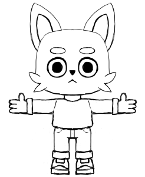
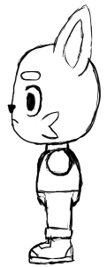

# Choose Your Character

Choose Your Character is a small character-selection website. Pick a character to open their own page, where their name and description are shown. I’m also learning Blender to create a 3D character for the project.

## Current features

- Choose from five characters: Mochi, Ash, Mila, Milo, and Nonna.
- Open a character details page with the selected character’s name and description.
- View the front and side sketches I’m using as Blender references.

The Blender character is still in progress and has not been added to the website yet.

## Built with

- HTML
- CSS
- JavaScript
- Blender

## Run locally

Open `index.html` in a browser, or start a local server from the project folder:

```bash
python -m http.server 8000
```

Then visit `http://localhost:8000`.

## Character sketches

### Front view



### Side view


